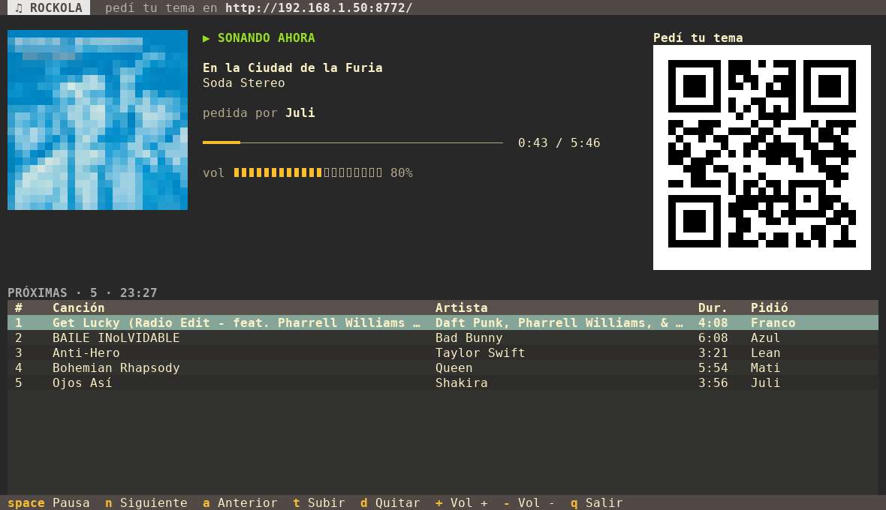
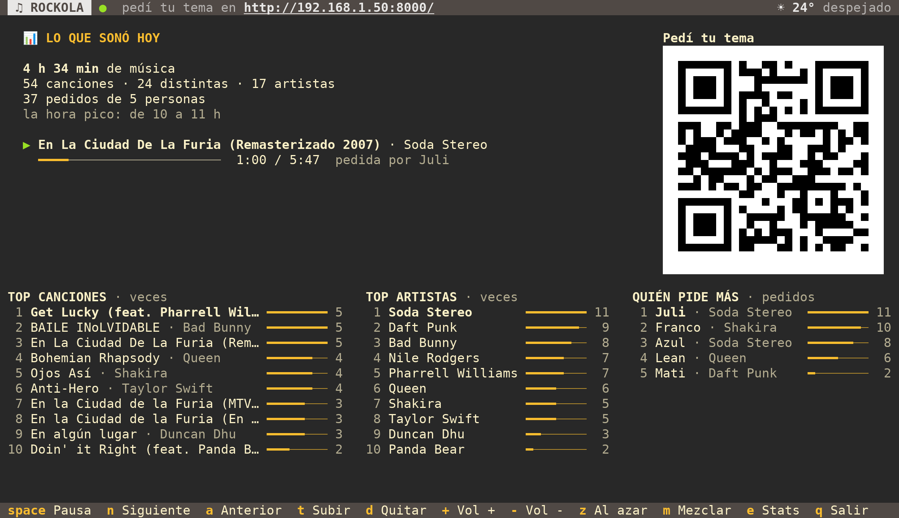
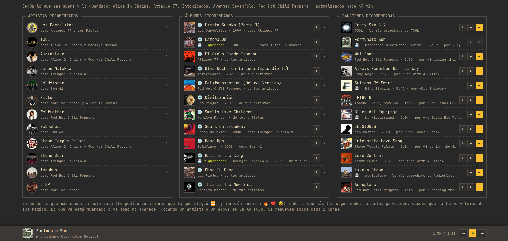
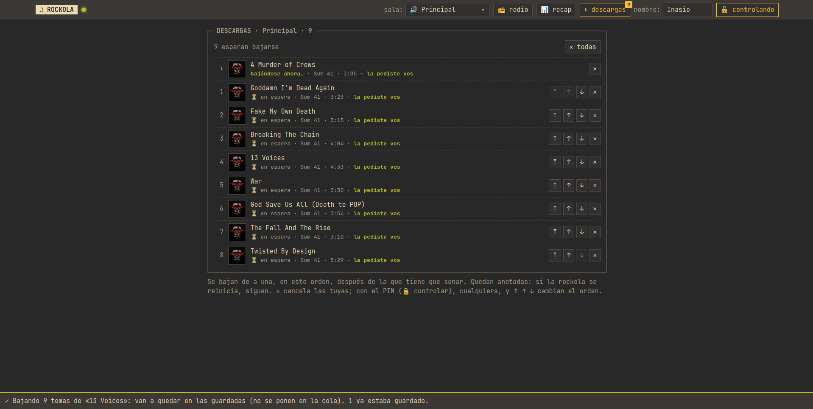
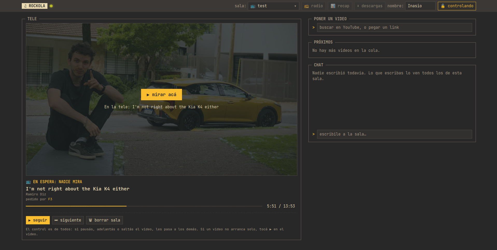
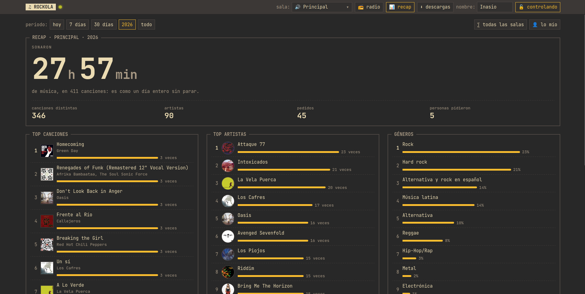
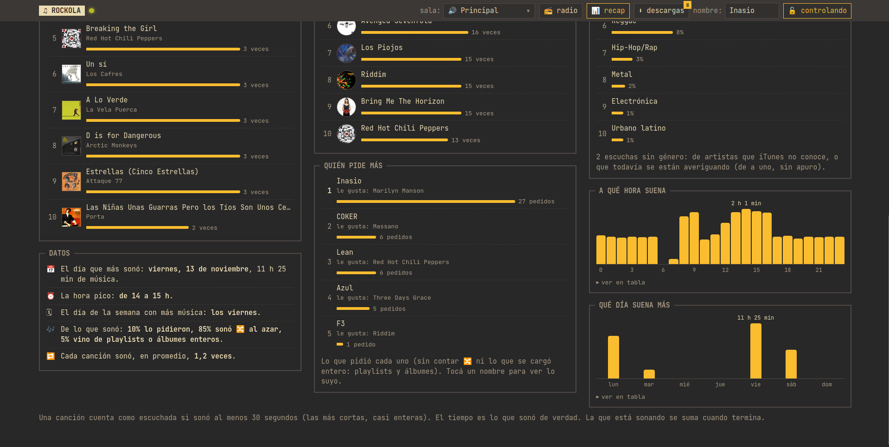
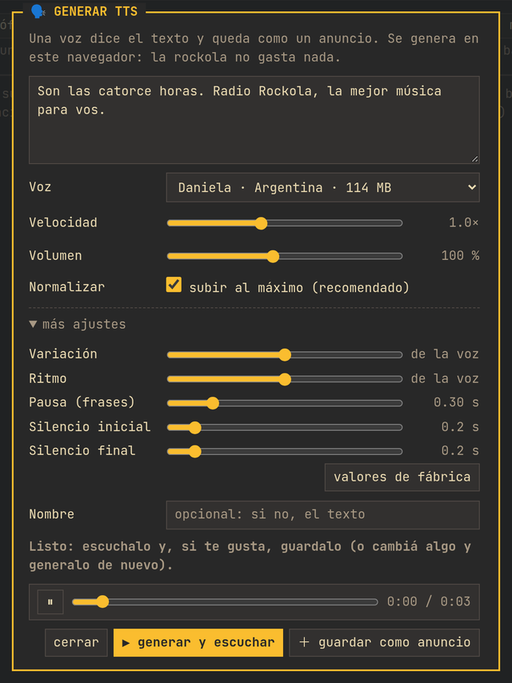

# 🎵 Rockola

**La música de la oficina, a pedido.** Tus compañeros buscan temas desde el celular (escaneando un
QR) y los suman a una cola compartida. Una Raspberry con pantalla y parlante los hace sonar y
muestra qué está sonando, quién lo pidió y qué viene después.

## Cómo se ve

|  |  |
|:---:|:---:|
| **En la pantalla de la Raspberry:** lo que suena, quién lo pidió, la cola y el QR para pedir | Cada 15 segundos le deja el lugar a lo más escuchado (de hoy, de la semana, del año) |

|  |  |
|:---:|:---:|
| **La página**, con el PIN puesto: la letra y el chat, lo que suena y la cola, el buscador y las guardadas | **🧭 Recomendados:** artistas, álbumes y canciones según lo que más suena y lo guardado; abajo, el mini reproductor |
|  |  |
| **⬇ Descargas:** lo que espera para bajarse, en el orden que quieras | **📺 Sala de tv:** videos de YouTube entre varios, a la par |
|  |  |
| **📊 Recap:** cuánto sonó y el top de canciones, artistas y géneros | Quién pide más, a qué hora y qué día suena |
|  | |
| **🗣️ Generar tts:** una voz dice lo que escribas, y queda como anuncio | |

## Qué tiene

- **Pedir desde el celular:** se busca en YouTube Music (sin cuentas ni API keys) o se pega un link; el QR de la
  pantalla lleva directo a la página.
- **Cola compartida en tiempo real**, con un límite por persona: cada uno quita las suyas.
- **👍 Votos y 🔥 ❤️ 😴 reacciones:** las más votadas suben, y si varios votan ⏭, la que suena se saltea sola.
- **Letra en sincro** de lo que suena.
- **Canciones guardadas:** lo que suena queda en la tarjeta (16 GB, se puede cambiar) y la próxima vez suena al
  instante. Se recorren por álbum, artista, género o las de recién. **⬇** guarda un tema, un álbum o una playlist sin
  pasar por la cola, y la **📚 biblioteca** completa muchos álbumes de una.
- **🔀 Al azar** cuando la cola se vacía: de lo guardado, de lo que YouTube Music da como relacionado, o mitad y mitad.
- **🧭 Recomendados**, como en las apps de música: artistas, álbumes y canciones nuevos según lo que más suena y lo
  que más hay guardado.
- **♫ Playlists propias**, y álbumes, playlists de YouTube, artistas o géneros enteros a la cola.
- **📻 Radio:** cada uno escucha en su compu, con auriculares, lo mismo que suena, a la par y con su volumen.
- **🚪 Salas:** cada equipo con su cola, su PIN y sus guardadas (se escuchan con 📻 radio).
- **📺 Salas de tv:** videos de YouTube entre varios, cada uno en su navegador, a la par.
- **🎙️ Voz:** el micrófono abierto en el parlante y anuncios que se repiten: grabados, subidos o dichos por una voz.
- **📊 Recap**, tipo "wrapped": lo más escuchado, quién pide más y a qué hora suena, por sala y por período.
- **💬 Chat** en cada sala, con el registro de quién salteó, votó o reaccionó.
- **Control con PIN:** pausa, volumen, ⏮ ⏭, reordenar arrastrando, mezclar, quitar y 🎚️ crossfade.
- **Pantalla tipo terminal** en la Raspberry (y `/pantalla`, para cualquier tele), **[botones físicos](docs/botones.md)** sin soldar y un
  **[gabinete imprimible en 3D](docs/gabinete.md)**.
- **Raspberry lista para usar:** un instalador, audio por jack, HDMI, USB o parlante Bluetooth, arranque automático y
  actualización diaria.
- **Robusta:** sin silencios entre temas. Si se reinicia, sigue donde estaba (el mismo tema, en el mismo segundo, con
  la cola); si se corta internet, la música sigue con lo guardado, con sus tapas y sus letras.
- **El clima** de tu ciudad, en la barra de arriba.

## Cómo funciona

```
                ┌──────────────────────────── server.py ────────────────────────────┐
 celulares ───→ │ cola compartida · búsqueda (ytmusicapi) · API HTTP con long-poll  │
 (pedir y, con  │                                                                   │
  PIN, manejar) │ modo mpv:       yt-dlp descarga → mpv reproduce → parlante        │
                │ modo navegador: el reproductor de YouTube en /player              │
                └───────────────────────────────────────────────────────────────────┘
                     ▲                        ▲                         ▲
                  tui.py                  /pantalla                controles.py
             (terminal, teclas)      (navegador, sólo mirar)    (botones en el GPIO)
```

Todo habla con el servidor por la misma API. La pantalla, los botones y la web son clientes:
si uno falla, la música sigue.

## Probarla en tu PC

Necesita Linux (o algo parecido, con bash) y **Python 3.11** o más nuevo.

```bash
git clone https://github.com/<tu-usuario>/rockola.git
cd rockola
sudo apt install mpv     # opcional: sin mpv, la música suena en una pestaña del navegador
./iniciar.sh             # la primera vez instala todo en .venv y crea rockola.toml con un PIN
./tui.sh                 # en otra terminal: la pantalla
```

La consola muestra el link para los compañeros (`http://<tu-ip>:8000/`) y el PIN. Qué cambia con mpv o sin él: los
[dos modos](docs/configuracion.md#dos-modos).

## Usarla

Los compañeros entran al link (o escanean el QR), ponen su nombre arriba, buscan y tocan **+ agregar**. Quien maneja
la música toca **🔒** y pone el PIN. Todo lo demás, función por función, está en [Cómo se usa](docs/uso.md).

## En una Raspberry

La guía de la [Raspberry Pi](docs/raspberry.md) va paso a paso. En corto:

```bash
rsync -av --exclude .venv ./ usuario@rockola.local:~/RockolaPi/   # desde tu PC
ssh usuario@rockola.local
cd ~/RockolaPi && ./pi/instalar.sh && sudo reboot                 # en la Pi
./pi/bluetooth.sh buscar                                          # opcional: parlante BT
```

## Guías

| | |
|---|---|
| **[Cómo se usa](docs/uso.md)** | La página, la pantalla y la terminal, función por función. |
| **[Configuración](docs/configuracion.md)** | Las opciones de `rockola.toml` y los dos modos (mpv o navegador). |
| **[Raspberry Pi](docs/raspberry.md)** | Qué imagen grabar, instalación, salida de audio, parlante Bluetooth, problemas comunes. |
| **[Botones](docs/botones.md)** | Pulsadores táctiles al GPIO sin soldar: piezas, armado, conexión y pruebas. |
| **[Gabinete](docs/gabinete.md)** | El modelo 3D: piezas para imprimir, armado, cómo colgarlo y cómo ajustar las medidas a tu pantalla. |
| **[Por dentro](docs/por-dentro.md)** | Qué hay en el repo, cómo funciona cada parte y qué datos se le mandan a quién. |

## Si algo falla

- **Todas las canciones dicen "Salteada":** casi siempre es yt-dlp desactualizado:
  `.venv/bin/pip install -U "yt-dlp[default]"` y reiniciá.
- **La búsqueda no anda:** `.venv/bin/pip install -U ytmusicapi`.
- **«YouTube pide una cuenta para confirmar la edad»:** es un video con restricción de edad, que
  sin una cuenta de un mayor no se puede bajar. Cuando es de un tema, la rockola baja sola la
  versión de audio (la del disco), que no tiene restricción; ese aviso queda sólo si no encuentra
  una: pasa con videos que no son un tema, o con versiones que no están en ningún disco.
- **Los compañeros no pueden entrar:** que estén en la misma red (las redes de "invitados" suelen
  aislar los dispositivos) y que el firewall deje pasar el puerto (`sudo ufw allow 8000/tcp`).
- Más casos en la [guía de la Raspberry](docs/raspberry.md#11-si-algo-falla) y la de [botones](docs/botones.md#si-algo-no-anda).

## Aviso

Es un proyecto personal, para usar en una oficina entre conocidos. No está afiliado a YouTube ni a
Google, ni cuenta con su aval.

- **Herramientas no oficiales:** la búsqueda usa [ytmusicapi](https://github.com/sigma67/ytmusicapi)
  y el modo mpv, [yt-dlp](https://github.com/yt-dlp/yt-dlp). Ninguna de las dos es de YouTube. Se
  instalan como dependencias desde sus propios proyectos: este repo no incluye su código ni
  música. Pueden dejar de andar cuando YouTube cambia algo.
- **Términos de YouTube:** en modo mpv se descarga el audio, y la 📻 radio lo comparte con otras
  compus de la red. Los términos de YouTube no lo permiten. El modo navegador usa el reproductor
  oficial (la búsqueda igual pasa por ytmusicapi). Las 📺 salas de tv también: cada uno ve el
  video en el reproductor oficial, sin bajar nada (la búsqueda de videos pasa por yt-dlp).
- **Cada uno es responsable** de cómo la usa: de cumplir los términos de YouTube y las leyes de
  derechos de autor de su país.
