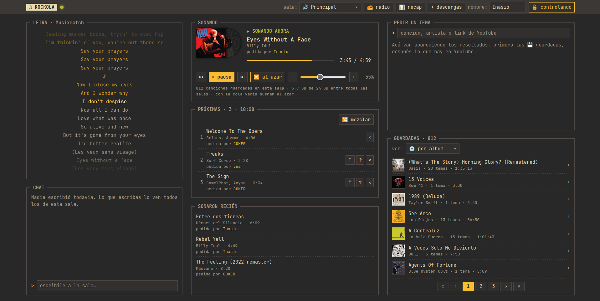
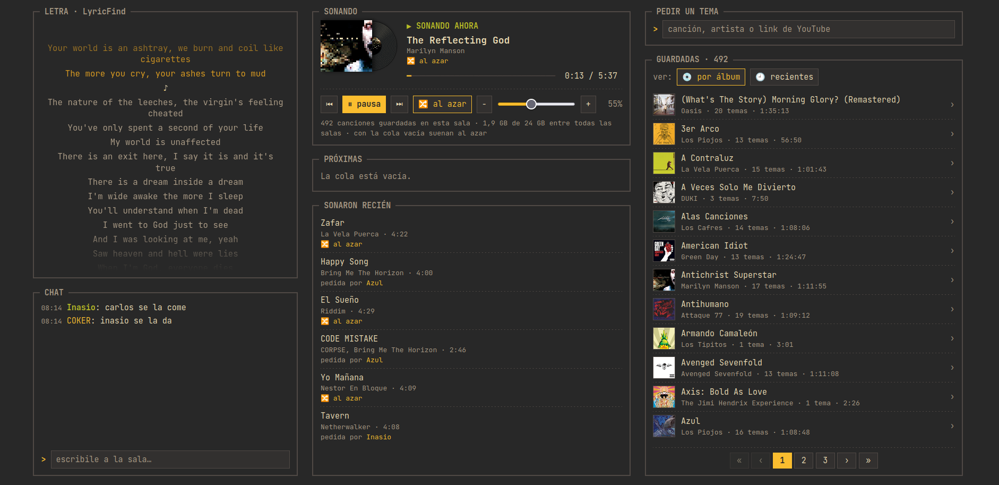
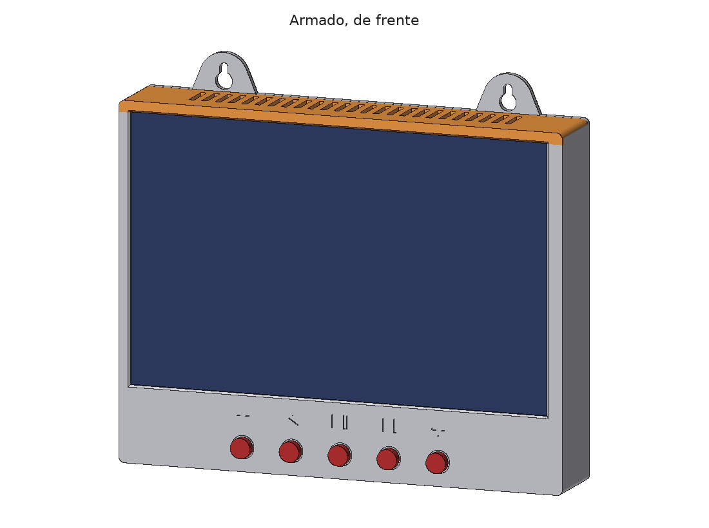
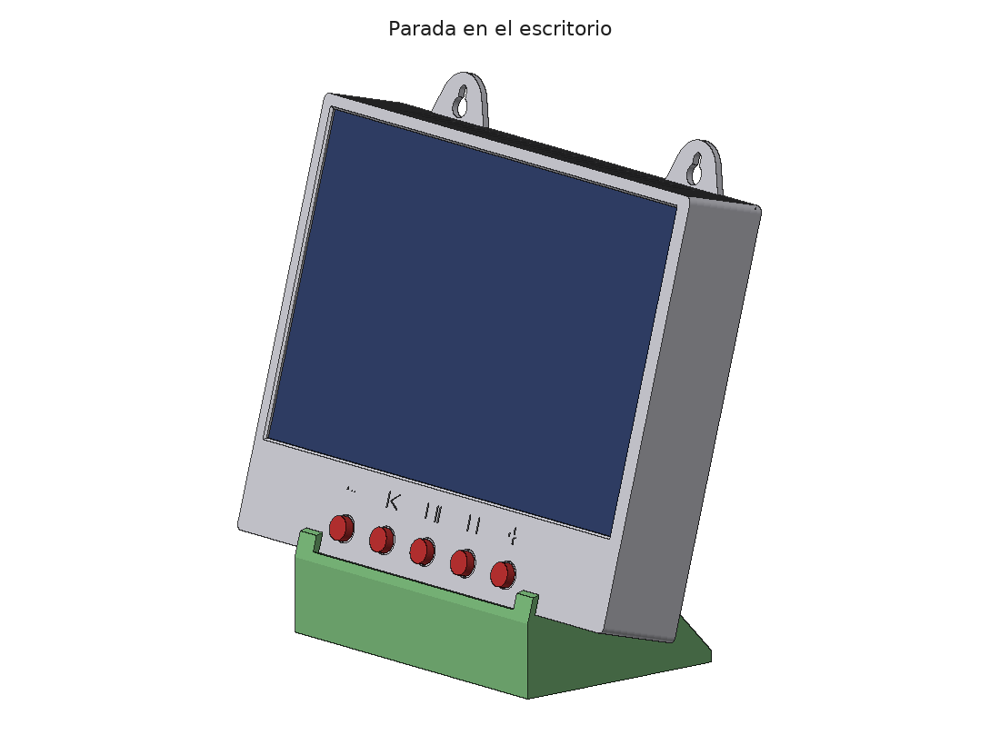

# 🎵 Rockola

**La música de la oficina, a pedido.** Tus compañeros buscan temas desde el celular (escaneando un
QR) y los suman a una cola compartida. Una Raspberry con pantalla y parlante los hace sonar y
muestra qué está sonando, quién lo pidió y qué viene después.


## Cómo se ve

|  |  |
|:---:|:---:|
| **Pedir un tema** via web | **Con el PIN:** pausa, volumen, anterior/siguiente y la cola |


## Qué tiene

- **Pedir desde el celular:** búsqueda en YouTube Music, sin cuentas ni API keys. También se puede
  pegar un link de YouTube. El QR de la pantalla lleva directo a la página.
- **Cola compartida en tiempo real**, con límite de canciones por persona. Cada uno puede quitar
  las suyas.
- **Canciones guardadas y modo aleatorio:** lo que se baja queda guardado en la tarjeta (hasta 16 GB,
  se puede cambiar); si lo vuelven a pedir, suena al instante. En la página se ven todas, por
  álbum, por género o las de recién, con su tapa, y se pueden pedir de ahí. Con **🔀 al azar**, cuando la cola se vacía suenan canciones
  guardadas al azar.
- **♫ Playlists propias:** cualquiera arma las suyas en la rockola (quedan guardadas, por sala) y
  les suma temas con **♫+** desde la búsqueda, los álbumes, las guardadas, la cola o lo que suena.
- **Álbumes, playlists y géneros enteros:** con el PIN, **▶ reproducir** (ya, en orden) o **+ a la cola**
  un álbum de YouTube Music, uno de las guardadas, una playlist propia o una de YouTube (pegando el
  link; también mixes), o todo lo guardado de un género (mezclado). Se puede sacar entero de la
  cola de un toque.
- **📻 Radio:** cada uno escucha en su compu, con auriculares, lo que suena en la rockola: el mismo
  tema en el mismo segundo, con su propio volumen. Anda aunque el parlante esté apagado o en 0.
- **🚪 Salas:** la principal suena en el parlante de la Raspberry; las otras (las crea cualquiera
  desde la web) no tienen parlante y se escuchan con 📻 radio. Cada una tiene su cola, su PIN, su
  🔀 al azar y sus guardadas: lo que pide ventas no se mezcla con lo de tu equipo, pero un tema
  que ya bajó otra sala suena al instante, sin bajarlo de nuevo.
- **💬 Chat** en cada sala.
- **📺 Salas de tv:** para mirar videos de YouTube entre varios, cada uno en su navegador. Van a
  la par: si alguien pausa, adelanta o salta el video, les pasa a todos. Con su cola y su chat.
  No pasan por la Raspberry: no se baja nada ni suena en el parlante.
- **📊 Recap**, tipo "wrapped": las canciones, los artistas y los géneros más escuchados, quién pide
  más, cuánto tiempo sonó y a qué hora, por sala y por período (hoy, 7 o 30 días, el año, todo).
  Queda en una base que sobrevive a los reinicios.
- **Control con PIN desde la web:** pausa, volumen, anterior/siguiente, reordenar, mezclar la cola y
  quitar cualquier canción. El resto ve la página normal.
- **Pantalla tipo terminal:** una TUI con la tapa del disco pixelada, la cola y el QR. Hay una versión
  web con la misma estética (`/pantalla`) para cualquier tele o monitor.
- **Botones físicos** (volumen, anterior, play/pausa, siguiente) conectados al GPIO **sin soldar**.
  Doble toque en − / + también es anterior / siguiente.
- **Raspberry Pi lista para usar:** un instalador, audio por jack, HDMI, USB o **parlante Bluetooth**
  (que se reconecta solo), arranque automático y actualización diaria.
- **Gabinete imprimible en 3D**, paramétrico, que se cuelga de la pared o se apoya en un soporte. El
  generador **verifica con las piezas reales** que todo encaje antes de imprimir.
- **Robusta:** mientras suena una canción, baja de a una las que siguen en la cola (sin silencios
  entre temas, y ⏭ es instantáneo) y se recupera sola si el reproductor se cae o se cuelga. **Si se
  reinicia** (p. ej. para actualizarla o aplicar un cambio), **sigue donde estaba:** el mismo tema,
  en el mismo segundo, con la cola de cada sala.

| | |
|:---:|:---:|
|  |  |
| Gabinete para colgar, con botonera | Teclas para pulsadores de 6×6, sin soldar |
|  |  |
| Soporte para el escritorio | Diagrama de conexión de los botones |

## Cómo funciona

```
                ┌──────────────────────────── server.py ────────────────────────────┐
 celulares ───→ │ cola compartida · búsqueda (ytmusicapi) · API HTTP con long-poll  │
 (pedir y, con  │                                                                   │
  PIN, manejar) │ modo mpv:       yt-dlp descarga → mpv reproduce → parlante        │
                │ modo navegador: el reproductor de YouTube en /player              │
                └───────────────────────────────────────────────────────────────────┘
                     ▲                        ▲                         ▲
                  tui.py                  /pantalla                controles.py
             (terminal, teclas)      (navegador, sólo mirar)    (botones en el GPIO)
```

Todo habla con el servidor por la misma API. La pantalla, los botones y la web son clientes:
si uno falla, la música sigue.

## Probarla en tu PC

Necesita Linux (o algo parecido, con bash) y **Python 3.11** o más nuevo.

```bash
git clone https://github.com/<tu-usuario>/rockola.git
cd rockola
sudo apt install mpv     # opcional: sin mpv, la música suena en una pestaña del navegador
./iniciar.sh             # la primera vez instala todo en .venv y crea rockola.toml con un PIN
./tui.sh                 # en otra terminal: la pantalla
```

La consola muestra el link para los compañeros (`http://<tu-ip>:8000/`) y el PIN.

## Usarla

- **Compañeros:** entran al link o escanean el QR, ponen su nombre, buscan y tocan **+ agregar**.
  Hay un solo buscador, sin botón: mientras escribís aparecen las **💾 guardadas** que coinciden
  (las palabras en cualquier orden) y, cuando dejás de escribir, abajo de ellas lo que hay en
  YouTube (con Enter, sin esperar). Las guardadas suenan sin esperar la descarga.
- **Letra:** la de la que suena (a la izquierda en la compu; debajo de lo que suena en el
  celular), de YouTube Music o, si ahí no está o no trae los tiempos, de [LRCLIB](https://lrclib.net).
  El título dice de dónde vino (LyricFind o Musixmatch, que le dan las letras a YouTube, o
  LRCLIB). Si trae los tiempos, se va poniendo amarilla mientras se canta y se mueve sola; si
  no, queda para leerla.
- **Guardar sin pedir:** en los resultados de YouTube, **⬇ guardar** la baja para que quede entre
  las guardadas, sin ponerla en la cola (en modo mpv). Se bajan de a una, después de la que tiene
  que sonar; hasta 40 esperando a la vez, con las mismas reglas que para pedir (nada en vivo ni
  más largo que `duracion_maxima`). Las que esperan aparecen arriba de GUARDADAS (la que se está
  bajando, las que esperan y las que fallaron), y **✕** cancela una (o **✕ todas**): cada uno las
  suyas; con el PIN, cualquiera. Si ya se estaba bajando, termina pero no queda guardada.
- **💿 Álbumes:** buscando un disco o un artista («bocanada», «soda stereo») aparecen también sus
  álbumes, con cuántos temas hay guardados. Tocando uno se ven sus temas, para pedirlos de a uno
  o, con el PIN, **▶ reproducir** el disco entero (corta la que suena; lo que estaba en la cola
  sigue después) o ponerlo **+ a la cola**, al final.
- **Guardar un álbum entero:** en esos álbumes (modo mpv), **⬇ guardar** baja todos sus temas
  (o **⬇ completar**, los que faltan), sin ponerlos en la cola; mientras, dice cuántos faltan y
  al terminar avisa una sola vez. Un álbum a medias también se completa desde GUARDADAS: abrilo y
  tocá **⬇ completar** (lo busca en YouTube Music por nombre y artista). Ahí también está
  **▶ reproducir** (con el PIN): el disco entero, en el orden de YouTube Music, aunque falten temas
  por bajar (si YouTube no lo encuentra, suenan los guardados).
- **♫ Armar una playlist:** en el panel de abajo a la derecha (abajo de todo en el celular),
  **♫ playlists** y **+ nueva playlist**. Queda elegida para sumarle temas: aparece **♫+** al lado
  de cada tema (en la búsqueda, en un álbum abierto, en las guardadas, en lo que suena, en la cola
  y en lo que sonó) y **♫+ todos** en un álbum o una playlist de YouTube. **♫✓** quiere decir que
  ya está (tocalo para sacarlo); **✓ listo** termina. Abriéndola se ve en orden, se suben temas
  (↑), se sacan (✕), se le cambia el nombre (✎) o se borra (🗑): eso, quien la armó (desde el mismo
  navegador) o alguien con el PIN. Cualquiera pide sus temas de a uno; entera, **▶ reproducir** o
  **+ a la cola**, con el PIN. Cada sala tiene las suyas (hasta 50, de hasta 200 temas cada una).
- En **GUARDADAS** (abajo de todo en el celular; en la compu, a la derecha, debajo del buscador)
  están todas las que ya se bajaron, para recorrerlas: **💿 por álbum** (tocás uno y ves sus
  temas) o **🕘 recientes**, separadas en páginas (**♫ playlists**, al lado, muestra las playlists). Con el PIN, **🗑** borra una a mano: sale de
  las guardadas de la sala y, si ninguna otra sala la tiene, se borra el archivo (si está
  sonando o en la cola, cuando termine). Si vuelve a sonar, se vuelve a guardar.
- **🎸 Por género:** otra forma de ver las guardadas. Tocás un género y ves sus temas (por artista),
  para pedirlos de a uno o, con el PIN, **▶ reproducir** o **+ a la cola** el género entero:
  van mezclados, y si son más de 200, 200 al azar (cada vez, otros). El género es el del artista
  (ver **Géneros**, abajo): se va averiguando de a un artista, así que al principio muchas están
  en **Sin género** (ahí dice cuántos artistas faltan) y la lista se acomoda sola. En «Sin género»
  quedan los videos sueltos y los artistas que iTunes no conoce.
- **📻 Radio, con auriculares:** arriba a la derecha, **📻 radio** hace sonar en ese dispositivo lo
  que suena en la rockola, a la par (la letra queda en sincro): pausa, ⏭ y ⏮ los sigue sola. Cada uno
  con su volumen, así que si en la oficina prefieren silencio, con el PIN bajen la rockola a 0 y la
  música sigue en los auriculares. Se apaga tocándolo de nuevo, o con la tecla ⏸ del teclado o de los
  auriculares. Es del modo mpv, y necesita un navegador que reproduzca WebM/Opus (el formato en que
  vienen casi todos los temas), como Chrome, Edge o Firefox.
- **🚪 Salas:** arriba, **sala:** elige en cuál estás (🔊 la principal, la del parlante; 📻 las
  otras). Con **＋ nueva sala…** se crea una, con un nombre y un PIN: quien la crea queda
  controlándola (pausa, ⏭, 🔀, 🗑 borrarla); el PIN de la rockola vale en todas. Una sala sin
  parlante **suena mientras alguien la escucha** con 📻 radio: si nadie la escucha, queda en espera
  donde iba, así lo que piden no se pierde sonando para nadie. Para escucharla en una sala de
  reuniones, alcanza con una compu con 📻 prendida y su parlante. El link de una sala es
  `http://<ip>:8000/?sala=ventas` (y `/pantalla?sala=ventas`, para una tele). Hay hasta 8 salas;
  al borrar una se pierden su cola, su chat, sus ♫ playlists y su 📊 recap, y sus canciones quedan
  bajadas por si otra sala las quiere.
- **Guardadas de cada sala:** cada sala ve en GUARDADAS, en lo que sugiere el buscador y en el 🔀
  sólo las suyas: las que sonaron en ella y las que guardó con ⬇. Si pedís (o guardás con ⬇) una
  que ya bajó otra sala, suena sin esperar y pasa a ser también de la tuya. El espacio
  (`guardar_gb`) es uno solo para todas.
- **💬 Chat:** el de la sala en la que estás (en la compu, a la izquierda, debajo de la letra).
  Escribís y Enter. Se borra cuando se reinicia la rockola.
- **📺 Salas de tv:** en el mismo menú de **sala:** están las de tv, y **＋ nueva sala de tv…**
  crea una (con un nombre y un PIN, como las otras). Son otra página: `http://<ip>:8000/tv?sala=almuerzo`
  (`/tv` a secas las lista). Ahí se busca un video de YouTube (cualquiera, no sólo música) o se pega
  su link, y **+ agregar** lo pone en la cola de la sala: hasta `max_por_persona` esperando por
  persona, y cada uno quita los suyos. Para verlo, **▶ mirar acá**: cada uno lo ve en su navegador,
  con su volumen, en el reproductor de YouTube (pantalla completa, subtítulos y calidad, los de
  siempre), y todos van por el mismo segundo.
  - **El control es de todos:** si alguien pausa, le da play o mueve el video (en el video mismo
    o con **⏸ pausa** y **⏭ siguiente**, abajo), les pasa a todos, y dice quién fue. Con el PIN
    de la sala (o el de la rockola), **🔒 controlar** suma lo que no es de todos: quitar (✕) o
    adelantar (⤒) videos de otro y **🗑 borrar sala**.
  - **Corre mientras alguien mira:** cada video arranca cuando el primero lo tiene andando (nadie
    se pierde el principio por lo que tarde en cargar), y si se van todos queda en espera, donde
    iba. El que entra tarde cae donde van los demás.
  - También transmisiones **en vivo** (ahí no hay segundo que seguir: se comparten la pausa y el play).
  - La publicidad es de cada uno: al que le toca, cuando termina alcanza a los demás (con YouTube
    Premium en ese navegador, no hay). Un video que no deja verse fuera de YouTube se saltea solo.
  - Hay hasta 8, y andan en los dos modos. Quedan guardadas entre reinicios, con su cola y por
    dónde iba el video (el chat no).
- **📊 Recap:** arriba, **📊 recap** cambia la cola por el recap, en la misma página: la 📻 radio sigue
  sonando, y se vuelve tocándolo de nuevo (o con ← del navegador). Su link es
  `http://<ip>:8000/recap`, y se actualiza solo cuando termina un tema. Muestra cuánto sonó, el top de
  canciones, artistas y géneros, **quién pide más** (con su artista favorito), a qué hora y qué día
  suena más, el día récord y la más salteada. Arriba se elige el período (hoy, 7 días, 30 días, cada
  año, todo) y, si hay varias salas, cuál (o **∑ todas**). Tocando un nombre se ve lo que pidió esa
  persona; **👤 lo mío**, lo tuyo (con el nombre que pusiste). Cuenta como escuchada una canción que
  sonó al menos 30 segundos (las más cortas, casi enteras): las que se cortan antes suman tiempo y
  cuentan como pedidas, pero no para los rankings. En «quién pide más» no entran 🔀 ni lo que se
  cargó entero (playlists y álbumes). Las de cada persona se juntan por el nombre, sin fijarse en mayúsculas ni acentos.
- **Quien maneja la música:** en la misma página, **🔒 controlar** y el PIN. Aparecen ⏮ ⏸ ⏭, el
  volumen y botones para reordenar (⤒ ↑) o quitar (✕) cualquier canción. Al lado de cada
  **+ agregar** (en la búsqueda y en las guardadas) aparece **▶ ahora**: corta la que suena (queda
  en "sonaron recién", como con ⏭) y pone esa; la cola sigue igual.
- **Mezclar la cola:** con el PIN, **🔀 mezclar** arriba de las próximas. Las pone en otro orden al
  azar, una vez: lo que pidan después va al final, como siempre. Sirve, por ejemplo, después de
  cargar una playlist (ojo, que mezcla también los pedidos que ya estaban).
- **Música de fondo:** con el PIN, **🔀 al azar**. Cuando la cola se vacía, suenan canciones que ya
  sonaron alguna vez (sin repetir las de recién); lo que pidan va primero, cuando termina la que
  está sonando. **Al prender la Raspberry, o al reiniciar la rockola (p. ej. al actualizarla), si
  en 10 segundos nadie pidió nada, se prende solo y arranca a sonar** (con un parlante Bluetooth,
  en cuanto se conecta); se apaga con `azar_al_prender = false`. Si cuando se apagó estaba sonando
  un tema, en lugar del 🔀 sigue ése, donde iba (ver **Si se reinicia**, abajo). En el reinicio
  diario de las 6 no arranca solo: arranca cuando se termina la cola, al prenderlo de nuevo, o con
  ⏯ (también el de la botonera). **Ojo:** si se van todos, sigue sonando hasta que lo pausen.
- **Si se reinicia:** al volver a arrancar (`systemctl --user restart rockola`, `./iniciar.sh`, o si
  se corta la luz), cada sala sigue donde estaba: lo que sonaba, en el segundo en que iba (si se
  cortó la luz, unos segundos antes), y la cola tal cual, cada tema con quien lo pidió (así cada
  uno puede seguir quitando los suyos). Si estaba en pausa, queda en pausa. En el reinicio diario
  de las 6 queda todo como estaba, pero en pausa (la oficina está vacía): ⏯ lo sigue. Al prender la
  Raspberry también, y con `azar_al_prender` sigue solo cuando el parlante está listo. El chat se
  borra.
- **Poner una playlist de YouTube:** con el PIN, pegá su link en la búsqueda y tocá **+ a la cola**
  (o **▶ reproducir**, para que suene ya). Sus temas van al final de la cola (como mucho 200; se
  saltean los repetidos y los muy largos), así que lo que pidan después suena cuando termine la
  playlist; con ⤒ se adelanta un pedido. Lo mismo con un álbum o una ♫ playlist propia. Arriba de
  la cola aparece cada una que se cargó (♫ o 💿) con **✕ quitar todos**, para sacarla entera.
- **En la terminal** (`./tui.sh`):

  | tecla | | tecla | |
  |---|---|---|---|
  | `espacio` | pausa | `↑` `↓` | elegir en la cola |
  | `n` | siguiente | `t` | que suene a continuación |
  | `a` | anterior / desde el principio | `d` | quitar |
  | `+` `-` | volumen | `z` | aleatorio (🔀) |
  | `q` | salir (la música sigue) | `m` | mezclar la cola |

  Opciones: `--tema nord` (o `tokyo-night`, `dracula`…) y `--url http://otra-maquina:8000`.
- **En una tele:** `http://<ip>:8000/pantalla`.

### Dos modos

| | **mpv** (por defecto si está instalado) | **navegador** (`--modo navegador`) |
|---|---|---|
| Dónde suena | en la máquina del servidor | en la pestaña `localhost:8000/player` |
| Términos de YouTube | descargar el audio va contra los términos | usa el reproductor oficial |
| Mantenimiento | yt-dlp se actualiza solo una vez por día | ninguno |
| Canciones guardadas y 🔀 | sí | no |
| 📻 Radio | sí | no |
| 🚪 Salas | sí | no (hay una sola) |
| 📺 Salas de tv | sí | sí |

## Guías

| | |
|---|---|
| **[Raspberry Pi](docs/raspberry.md)** | Qué imagen grabar, instalación, salida de audio, parlante Bluetooth, problemas comunes. |
| **[Botones](docs/botones.md)** | Pulsadores táctiles al GPIO sin soldar: piezas, armado, conexión y pruebas. |
| **[Gabinete](docs/gabinete.md)** | Piezas para imprimir, armado, cómo colgarlo y cómo ajustar las medidas a tu pantalla. |

En corto, para la Raspberry:

```bash
rsync -av --exclude .venv ./ usuario@rockola.local:~/RockolaPi/   # desde tu PC
ssh usuario@rockola.local
cd ~/RockolaPi && ./pi/instalar.sh && sudo reboot                 # en la Pi
./pi/bluetooth.sh buscar                                          # opcional: parlante BT
```

## Configuración

Todo está en `rockola.toml`; `iniciar.sh` lo crea a partir de
[`rockola.ejemplo.toml`](rockola.ejemplo.toml), donde cada opción está explicada.

| Opción | Por defecto | |
|---|---|---|
| `pin` | al azar | PIN para controlar desde la web (vacío = sólo desde la máquina) |
| `puerto` | `8000` | |
| `max_por_persona` | `3` | canciones pendientes por persona (y videos, en una sala de tv) |
| `duracion_maxima` | `600` | segundos (0 = sin límite) |
| `volumen` | `80` | volumen inicial (0–130) |
| `normalizar` | `false` | iguala el volumen entre canciones |
| `modo` | automático | `mpv` o `navegador` |
| `ip` | automática | la IP que muestran el link y el QR |
| `guardar_gb` | `16` | GB para canciones guardadas, entre todas las salas; al pasarlos se borran las que hace más que no suenan (0 = no guardar). Siempre deja 2 GB libres |
| `carpeta` | `~/.cache/rockola` | dónde quedan las canciones guardadas, las salas (también las de tv), las ♫ playlists y las estadísticas del recap |
| `azar_al_prender` | `true` | al prender la Raspberry o reiniciar el servicio, si en 10 s nadie pide nada: 🔀 prendido y a sonar (con un parlante Bluetooth, cuando se conecta); si estaba sonando un tema, sigue ése. No en el reinicio de las 6 |
| `predescargar` | `0` | canciones de la cola que se bajan por adelantado (0 = toda la cola) |
| `[controles]` | | pines de los botones, paso de volumen y doble toque |

## Qué hay en el repo

```
├── server.py             servidor: cola, búsqueda, API y el "director" que maneja mpv
├── reproductor.py        descargas con yt-dlp y control de mpv por su socket JSON IPC
├── estadisticas.py       lo que sonó, en SQLite, para el 📊 recap (y los géneros, de iTunes)
├── listas.py             las ♫ playlists que se arman en la rockola, por sala (listas.json)
├── tele.py               las 📺 salas de tv: el video que va, su reloj, la cola y el chat (tv.json)
├── tui.py                pantalla de terminal (Textual)
├── controles.py          botones físicos (gpiozero)
├── static/               páginas web: pedidos y 📊 recap (/), las salas de tv (/tv), /pantalla y /player
├── iniciar.sh, tui.sh    arrancar el servidor y la pantalla
├── rockola.ejemplo.toml  configuración de ejemplo
├── pi/                   instalador de la Raspberry, salida de audio y Bluetooth
├── hardware/             gabinete: generador paramétrico (manifold3d) y los STL
└── docs/                 guías e imágenes (capturas.py saca las de la web, diagrama.py el de los botones)
```

## Por dentro

- **Búsqueda:** [ytmusicapi](https://github.com/sigma67/ytmusicapi), la API no oficial de YouTube Music.
- **Letras:** primero las de YouTube Music (por ytmusicapi). Si no tiene, o la tiene sin tiempos, se
  le pregunta a [LRCLIB](https://lrclib.net), una base libre de letras con tiempos (sin cuenta ni
  clave): primero el tema exacto (título, artista, álbum y duración) y, si no está, por título y
  artista. Sus tiempos se usan sólo si la duración coincide (±3 s); si no, es otra versión y los
  renglones irían corridos, así que queda sin tiempos. Se le manda el título, el artista, el
  álbum y la duración de lo que suena, nada más.
- **Reproducción (modo mpv):** el *director* (en `server.py`) mira el estado y hace que mpv toque lo
  que corresponde. Cada tema se baja con [yt-dlp](https://github.com/yt-dlp/yt-dlp) (~5 MB).
  Mientras suena uno, se bajan de a una, en orden, todas las que siguen en la cola: si la mezclan o
  la reordenan, sigue con el orden nuevo; si al disco le quedan menos de 2 GB, frena. Como mucho hay
  dos descargas a la vez (para no ahogar a una Pi con poca memoria): la de la canción que tiene que
  sonar ya, si no estaba, y la de adelanto. Si mpv se cae o se cuelga, se reinicia y retoma la
  canción en el segundo en que iba. Para retomar, la carga en pausa, salta con `seek` (anda igual
  en todas las versiones de mpv) y recién ahí la suelta: no se oye el principio.
- **Canciones guardadas:** quedan en `~/.cache/rockola/canciones`, el audio y un `.json` con sus
  datos (título, artista, álbum, duración y tapa). La fecha del archivo marca la última vez que
  sonó: no hay un índice que se rompa si se corta la luz. En 16 GB entran unas 3000. El álbum sale
  de YouTube Music o, para las pedidas por link, de yt-dlp; a las que se guardaron antes de que se
  anotara, se lo pregunta de a una, sin apuro, un rato después de arrancar.
- **Deno** se instala en el entorno virtual para que yt-dlp resuelva los desafíos de JavaScript
  de YouTube.
- **📻 Radio:** no transmite el audio de la Pi (eso pediría ffmpeg y sumaría segundos de demora). La
  página baja de `/api/audio/<id>` el mismo archivo que está tocando mpv (sólo ese: no sirve para
  bajarse las guardadas) y lo hace sonar en el segundo que dice el estado; si se corre más de medio
  segundo, salta adonde va. Son unos 5 MB por tema y por oyente, por la red de la oficina.
- **🚪 Salas:** cada sala tiene lo suyo (cola, historial, chat, 🔀, avisos) y todas las páginas,
  la TUI y los botones le hablan a la misma API, con `sala=<id>` (sin nada: la principal). En la
  principal, mpv dice por dónde va; en las otras lo lleva un reloj en el servidor (el *director*
  baja la que toca, cuenta el tiempo y pasa a la siguiente), que corre sólo mientras alguna 📻
  está prendida: cada página con la radio prendida lo dice al pedir el estado, y si no se sabe
  nada de ella en 40 s se la da por apagada. Las salas (nombre, PIN con hash y 🔀) quedan en
  `~/.cache/rockola/salas.json`; la cola, en `colas.json` (ver abajo); el chat, en memoria. Cada guardada anota de qué salas
  es (`salas` en su `.json`; las de antes de las salas, de la principal). Cuando falta lugar se
  borran primero las que no son de ninguna (las de salas borradas).
- **📺 Salas de tv:** el servidor no toca el video: lleva la cuenta de cada sala (`tele.py`: qué
  video va, por qué segundo según un reloj, si está en pausa, la cola y el chat) y cada página hace
  que su reproductor de YouTube (el oficial, el mismo de `/player`) vaya a la par: carga ese video
  y, si se va más de un segundo y medio del reloj, salta adonde va. Al revés, cuando alguien toca
  el video de su página (pausa, play, lo mueve), la página se lo cuenta al servidor y de ahí les
  llega a las demás. Como el reproductor avisa igual sus cambios, los haya pedido la página o una
  persona, la página sólo toma por de una persona lo que pasa cuando el video ya estaba como decía
  la sala y dura un rato: así dos páginas no terminan pausándose entre sí, y un video frenado por
  el navegador (el celular con la pantalla bloqueada, una publicidad) no les pausa a todos. El reloj
  de un video arranca cuando la primera página avisa que ya lo tiene andando, y corre sólo
  mientras alguna tenga el video a la vista (lo dice al pedir el estado; a los 40 s sin noticias se
  la da por cerrada). La búsqueda es la de YouTube (con yt-dlp: sólo la lista de resultados, sin
  bajar nada), porque la de YouTube Music trae sólo música. Tienen su propio lock: lo que pasa en
  una sala de tv no despierta a la música. Quedan en `~/.cache/rockola/tv.json`.
- **📊 Estadísticas:** cada vez que un tema deja de sonar (terminó, ⏭, ▶ ahora…) se anota en `~/.cache/rockola/estadisticas.db` (SQLite, sin nada que instalar): la sala,
  cuánto sonó de verdad (no lo que dura), quién lo pidió y si fue pedido, de una playlist o 🔀. Lo
  escribe un hilo aparte, para no frenar la música. Si la base se rompe (un corte de luz justo
  mientras escribe), queda a un costado como `estadisticas.rota-<fecha>.db` y se empieza otra.
- **Géneros:** YouTube Music no los da. Se le pregunta a la [API de búsqueda de
  iTunes](https://performance-partners.apple.com/search-api) (pública, sin cuenta ni clave) por el
  primer artista de cada tema, de a uno cada 4 segundos, y queda anotado. Sólo se usa si el nombre
  coincide, así un video subido por cualquiera no se lleva un género inventado; esos quedan «sin
  género» (se vuelve a preguntar al mes). Se le manda el nombre del artista, nada más. Se
  pregunta por los artistas de lo que sonó (para el recap) y por los de las guardadas, aunque no
  hayan sonado nunca (para verlas **🎸 por género**): primero los más escuchados. Con muchas
  guardadas, la primera vez tarda (unos 15 artistas por minuto).
- **Tiempo real con long-poll:** las páginas, la TUI y los botones se enteran de cada cambio al
  instante, sin websockets ni dependencias.
- **Permisos:** cualquiera agrega temas, quita los suyos, chatea, crea salas y arma ♫ playlists
  (las cambia quien la armó: la página la reconoce por el mismo identificador con el que quita sus
  temas). Cargar un álbum o una playlist entera es con el PIN: si no, una persona llenaría la cola
  de una, sin el límite por persona. Lo demás se hace
  desde la misma máquina o con el PIN: el de la rockola, que vale en todas las salas, o el de la
  sala (5 intentos fallidos bloquean esa IP 5 minutos). Las páginas no pueden mandar pedidos de
  control desde otro sitio: el servidor exige JSON y revisa el `Host`. En una sala de tv el
  control del video (pausa, moverlo, ⏭) es de todos; el PIN es para la cola de otros y para borrarla.
- **Entre reinicios:** de cada sala, lo que suena (y en qué segundo), la cola con quién pidió cada
  tema y lo que sonó recién quedan en `~/.cache/rockola/colas.json`. Se escribe un par de segundos
  después de cada cambio, cada 30 s mientras suena algo (por si se corta la luz: no más seguido,
  para no gastar la tarjeta) y al apagar la rockola. Las salas, las canciones guardadas, el 🔀,
  las ♫ playlists (`listas.json`, con los datos de cada tema: se ven sin preguntarle a YouTube) y
  las estadísticas también quedan; el chat vive en memoria y se borra. El tema que sonaba cuando
  se apagó se anota en las estadísticas una sola vez, cuando termina después de retomarlo.

## Si algo falla

- **Todas las canciones dicen "Salteada":** casi siempre es yt-dlp desactualizado:
  `.venv/bin/pip install -U "yt-dlp[default]"` y reiniciá.
- **La búsqueda no anda:** `.venv/bin/pip install -U ytmusicapi`.
- **Los compañeros no pueden entrar:** que estén en la misma red (las redes de "invitados" suelen
  aislar los dispositivos) y que el firewall deje pasar el puerto (`sudo ufw allow 8000/tcp`).
- Más casos en la [guía de la Raspberry](docs/raspberry.md#11-si-algo-falla) y la de [botones](docs/botones.md#si-algo-no-anda).

## Aviso

Es un proyecto personal, para usar en una oficina entre conocidos. No está afiliado a YouTube ni a
Google, ni cuenta con su aval.

- **Herramientas no oficiales:** la búsqueda usa [ytmusicapi](https://github.com/sigma67/ytmusicapi)
  y el modo mpv, [yt-dlp](https://github.com/yt-dlp/yt-dlp). Ninguna de las dos es de YouTube. Se
  instalan como dependencias desde sus propios proyectos: este repo no incluye su código ni
  música. Pueden dejar de andar cuando YouTube cambia algo.
- **Términos de YouTube:** en modo mpv se descarga el audio, y la 📻 radio lo comparte con otras
  compus de la red. Los términos de YouTube no lo permiten. El modo navegador usa el reproductor
  oficial (la búsqueda igual pasa por ytmusicapi). Las 📺 salas de tv también: cada uno ve el
  video en el reproductor oficial, sin bajar nada (la búsqueda de videos pasa por yt-dlp).
- **Cada uno es responsable** de cómo la usa: de cumplir los términos de YouTube y las leyes de
  derechos de autor de su país.
