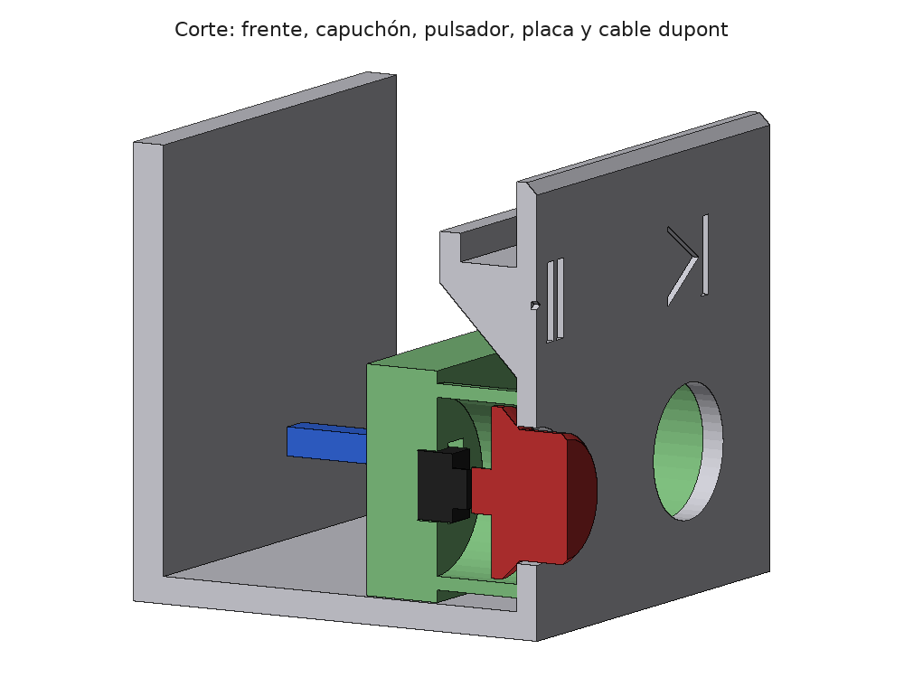
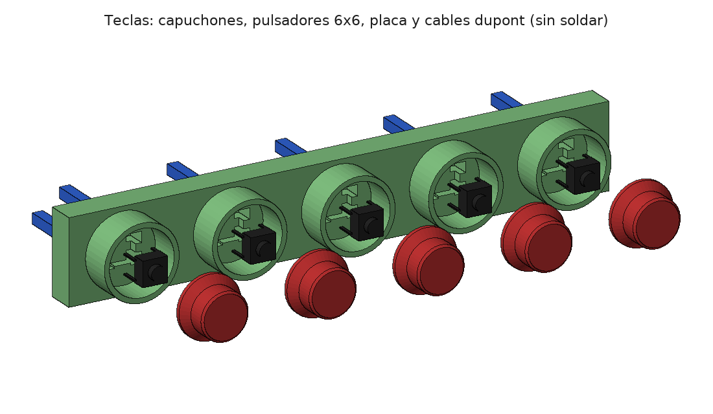
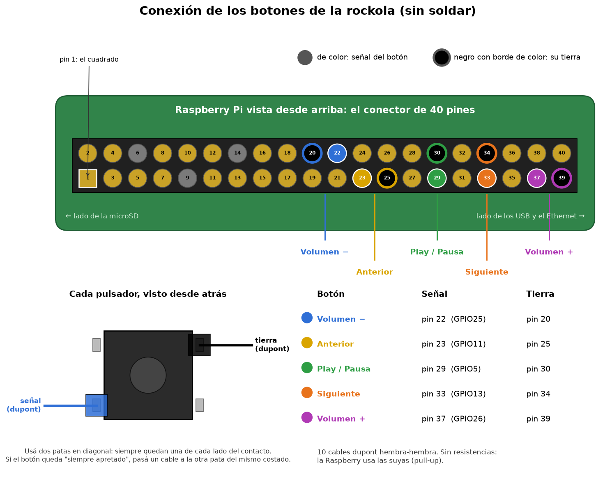

# Botones físicos

Cinco botones debajo de la pantalla, conectados directo al GPIO de la Raspberry.
**No hace falta soldar ni comprar nada raro**: pulsadores táctiles de 6×6 mm y cables dupont.

```
   [ − ]     [ ⏮ ]      [ ⏯ ]       [ ⏭ ]      [ + ]
  volumen   anterior  play/pausa  siguiente  volumen
```

- **⏮ Anterior:** si la canción va por más de 5 segundos, la vuelve a empezar; si no, vuelve a la
  anterior (y la que sonaba queda primera en la cola).
- **− / +:** de a 5 por toque; mantenidos, siguen bajando o subiendo.
- **⏯ sin nada sonando:** si el aleatorio (🔀) está prendido, arranca una canción guardada al azar.
- **Doble toque en − / +:** hace lo mismo que ⏮ / ⏭. Sirve si se rompe alguno de esos dos (o si
  querés armar la botonera con tres botones: −, ⏯ y +).
- Hacen lo mismo que los controles de la web (con PIN), que siguen andando igual.

## Qué hace falta

| | |
|---|---|
| 5 pulsadores táctiles de 6×6 mm | Los cuadraditos de 4 patas. Medí el alto total (cuerpo + botoncito): el diseño está hecho para **5 mm**. |
| 10 cables dupont hembra-hembra | De unos 25 cm. Dos por botón. |
| `placa_botones.stl` y `capuchones.stl` | Del gabinete ([gabinete.md](gabinete.md)). Vienen 6 capuchones: uno de repuesto. |
| Pegamento | Cianoacrilato ("la gotita") o silicona caliente. |

Si tus pulsadores no miden 5 mm de alto, cambiá `TECLA_ALTO` en `hardware/gabinete.py` y
regenerá la placa y los capuchones (`python hardware/gabinete.py`).

## Cómo va armado



El **capuchón** (rojo) pasa por el agujero del frente; su pestaña no lo deja salir. Atrás, la
**placa** (verde) sostiene el **pulsador** en un bolsillo, y su tubo apoya contra el frente: así la
distancia queda justa. Los **cables dupont** (azul) entran por ranuras abiertas atrás y se enchufan
directo en las patas del pulsador.



## Conexión

Cada botón usa **dos pines pegados** del conector: su señal y una tierra (GND) para él solo. Así
no hay que empalmar nada. Los pares van de izquierda a derecha en el mismo orden que los botones.



([versión en SVG](img/conexiones.svg), para imprimir grande)

| Botón | Señal | Tierra |
|---|---|---|
| Volumen − | pin **22** (GPIO25) | pin **20** |
| Anterior | pin **23** (GPIO11) | pin **25** |
| Play / Pausa | pin **29** (GPIO5) | pin **30** |
| Siguiente | pin **33** (GPIO13) | pin **34** |
| Volumen + | pin **37** (GPIO26) | pin **39** |

En el pulsador, los dos cables van en **patas opuestas en diagonal**. Así quedan siempre uno de
cada lado del contacto, sin importar cómo esté girado. No hacen falta resistencias: la Raspberry usa
las suyas internas (pull-up), que dejan cada pin "en 1" hasta que el botón lo une a tierra.

> **Nunca** conectes un botón a los pines de 3,3 V o 5 V: sólo a su GPIO y a una tierra.

## Armado paso a paso

1. **Pulsadores en la placa:** cada uno en su bolsillo, con las patas hacia las ranuras de los
   costados.
2. **Cables:** desde atrás, enchufá un dupont en una pata y otro en la pata opuesta en diagonal.
   Empujalos hasta el fondo de la ranura.
3. **Capuchones:** uno en cada tubo, con la espiga hacia el pulsador.
4. **Probá antes de pegar:** con la Raspberry andando, apoyá la placa contra el frente por dentro,
   con cada capuchón asomando por su agujero, y corré:

   ```bash
   systemctl --user stop rockola-controles     # libera los pines
   python3 ~/RockolaPi/controles.py --probar
   ```

   Cada toque tiene que mostrar **una** línea `apretaste: …` (en − y + aparece un poquito
   después: está esperando a ver si viene un doble toque). Ctrl+C para salir y
   `systemctl --user start rockola-controles` para volver.
5. **Pegá:** unas gotas en el borde de los cinco tubos. Apoyá la placa contra el frente, con los
   capuchones en sus agujeros y la placa apoyada en el piso, y sostenela un minuto.
6. **Al Raspberry:** subí los 10 cables por detrás de la pantalla y enchufalos según el diagrama.
   Conviene hacerlo antes de deslizar la pantalla.

## Si algo no anda

| Pasa… | Revisá |
|---|---|
| Un botón no hace nada | Que los cables estén en el par correcto. Contá desde el pin 1: es el de la pata cuadrada. |
| Un botón queda "siempre apretado" | Si los dos cables están en patas del mismo costado del pulsador, pasá uno a la diagonal. Si no, el capuchón aprieta de entrada: subí `TECLA_JUEGO` (0,4 mm) y reimprimí los capuchones, o limá un poco la espiga. |
| Hay que apretar mucho, o no hace clic | Hay demasiado juego: bajá `TECLA_JUEGO`, o pegá un papelito en la punta de la espiga. |
| Un dupont queda flojo en la pata | Las patas de los pulsadores son finitas: apretá un poco el contacto del dupont con una pinza, o poné una gota de silicona caliente. |
| Ninguno anda | ¿Está corriendo el servicio? `systemctl --user status rockola-controles` |
| Un toque cuenta como dos | Pulsador con mucho rebote: subí el `0.15` de `antirrebote()` en `controles.py`. |
| Se rompió ⏮ o ⏭ | Usá el doble toque: − dos veces es ⏮ y + dos veces es ⏭. Si el roto queda "siempre apretado", ponelo en `0` en `[controles]` de `rockola.toml`. |
| Apreté + varias veces rápido y salteó la canción | Es el doble toque. Para subir mucho el volumen, mantené apretado +. Si no lo querés, `doble_toque = 0` en `[controles]`. |
| El doble toque no sale, o sale sin querer | Cambiá `doble_toque` en `[controles]`: es el tiempo máximo entre los dos toques (0,4 s). Más alto es más fácil de hacer, pero el volumen tarda más en responder a un toque simple. |
| Quiero usar otros pines | Cambialos en `[controles]` de `rockola.toml` (numeración BCM). Para el diagrama, cambiá también `TIERRA_DE` en `docs/diagrama.py` y corré `python3 docs/diagrama.py`. |

**Botones de panel de 12 mm con tuerca:** también entran en el frente, sin placa ni capuchones.
Se cablean igual: una pata a la señal y la otra a la tierra.

Logs: `journalctl --user -u rockola-controles -f`.
