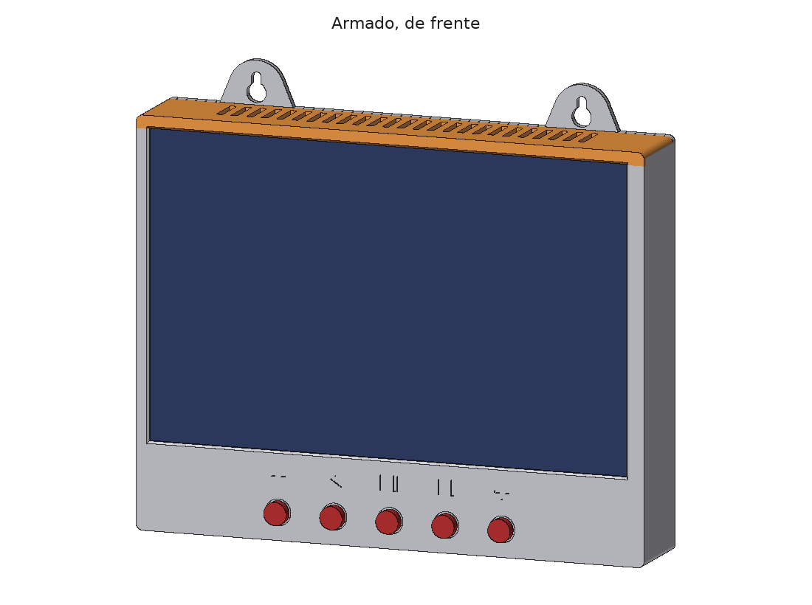
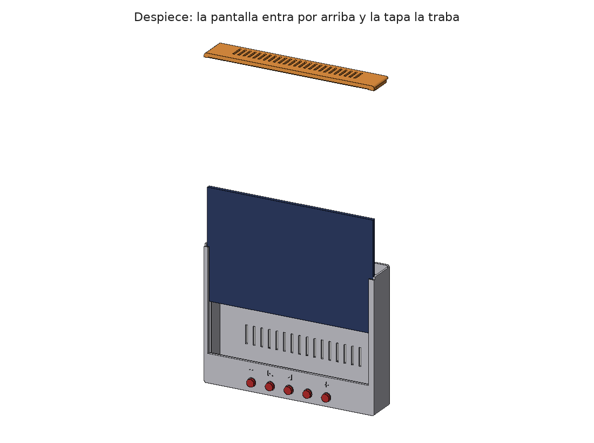
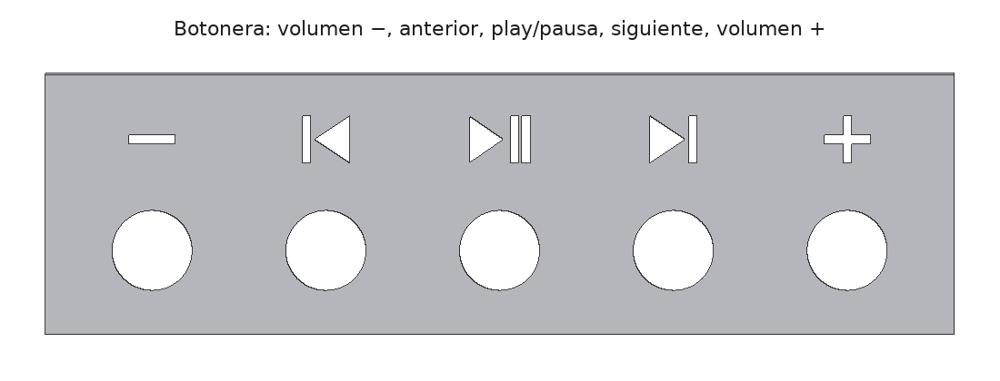
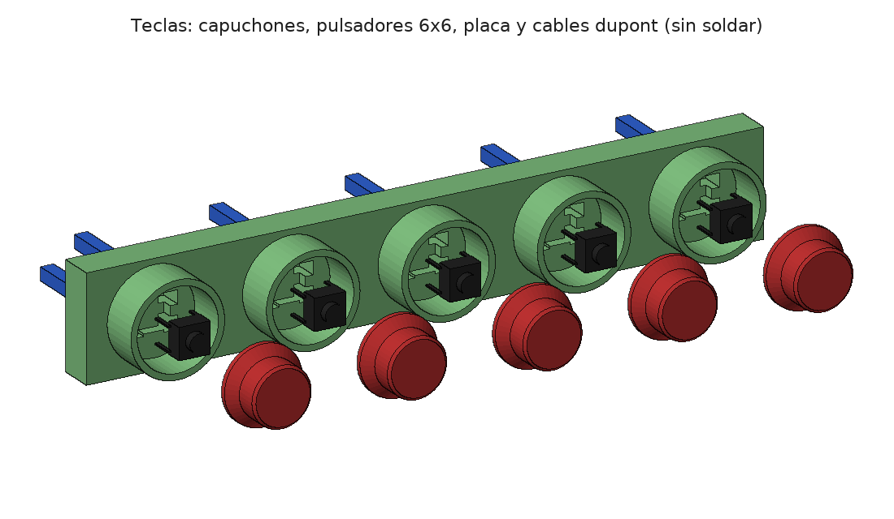
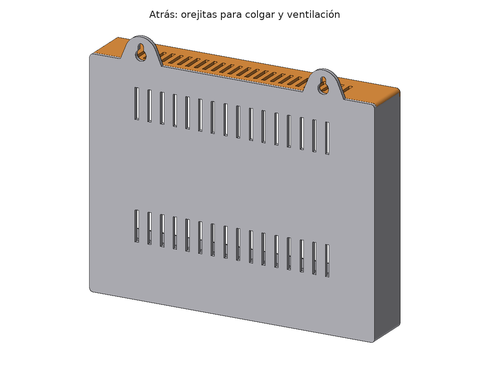
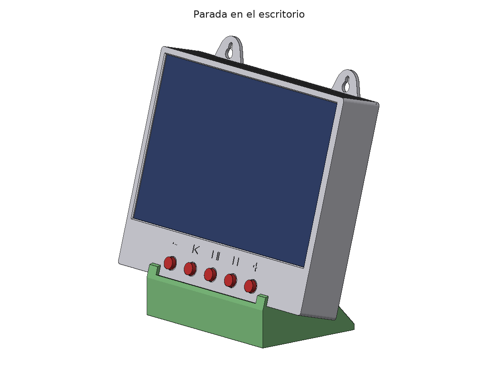

# Gabinete imprimible



Para una pantalla de **230 × 150 × 5 mm** (biseles: 3,5 mm arriba y a la izquierda, 6 mm a la
derecha, 8 mm abajo) con la Raspberry y la controladora pegadas atrás. Todas las medidas se
ajustan en [`hardware/gabinete.py`](../hardware/gabinete.py).

| Pieza | Para qué | Tamaño (como se imprime) |
|---|---|---|
| `cuerpo.stl` | Marco con botonera, paredes, fondo y orejitas para colgar | 236 × 40 × 205 mm (parado) |
| `tapa.stl` | Cierra arriba y traba la pantalla | 236 × 37 × 8 mm (boca abajo) |
| `placa_botones.stl` | Sostiene los 5 pulsadores táctiles; va pegada adentro | 130 × 20 × 15 mm |
| `capuchones.stl` | Las 5 teclas (+1 de repuesto) | 95 × 15 × 10 mm |
| `soporte.stl` | Opcional: para dejarlo parado en el escritorio | 150 × 99 × 54 mm |
| `prueba_ranura.stl` | Opcional: la parte de abajo del cuerpo, para probar el calce antes de imprimir todo | 236 × 40 × 47 mm |

Los STL están en [`hardware/`](../hardware), ya **orientados para imprimir** y **sin soportes**:
lo único en el aire son puentes cortos (arriba de las ranuras de ventilación, los ojales y los
agujeros de los botones).

## Cómo funciona



1. La pantalla, con todo lo que tiene pegado atrás, **entra deslizándose desde arriba** por una
   ranura. Adelante la sostiene el marco (que tapa los biseles); atrás, unos rieles que pisan 2,5 mm
   el borde. Apoya en un estante, arriba de la botonera.
2. La **tapa** entra a presión desde arriba y queda justo encima de la pantalla: ya no puede salir.
3. Colgado de la pared, el peso tira para abajo, contra el estante: no depende de ningún encastre
   ni tornillo.

## Botonera



Cinco agujeros de 12 mm con los íconos grabados arriba. Hay dos opciones:

- **Pulsadores táctiles de 6×6 mm** (sin soldar): van en `placa_botones`, que se pega por dentro,
  y los `capuchones` pasan por los agujeros. Ver [botones.md](botones.md).
- **Botones de panel de 12 mm con tuerca:** se atornillan directo. Detrás de cada agujero hay lugar
  para una tuerca de hasta 17 mm y 25 mm de botón con terminales.



## Imprimir

- **Cama:** el cuerpo y la tapa miden 236 mm de largo. Entran en camas de 250 mm o más (Prusa MK4,
  Bambu, etc.). En una de 220 × 220 entran **en diagonal**: rotalas 45° en el slicer.
- **Material:** PLA anda. Si va a estar al sol o cerca de una fuente de calor, mejor PETG: el PLA se
  ablanda alrededor de 55–60 °C, y adentro están la Raspberry y la controladora.
- **Capa** 0,2 mm, **paredes** 3 o más perímetros, **relleno** 15–20 %.
- **Cuerpo:** se imprime parado y es alto: usá **brim** de 5 mm.
- **Capuchones:** son chiquitos; si quedan con hilos, una pasada de lija fina en la parte que asoma.
- Tiempos aproximados (0,2 mm): cuerpo 10–12 h, tapa 1–1,5 h, soporte 4–5 h, placa 1 h,
  capuchones 20 min, prueba 2 h.

## Armar

1. **Cables primero:** pasá el Ethernet y los dos de alimentación **de afuera hacia adentro** por el
   agujero de abajo a la izquierda (pasa un conector RJ45).
2. **Botones:** ver [botones.md](botones.md).
3. Conectá todo a la Raspberry, acomodá el rollo de HDMI atrás y **deslizá la pantalla desde
   arriba** hasta que apoye en el estante.
4. Poné la **tapa** desde arriba, apretando parejo.

**Para colgar:** dos tornillos a **150,9 mm** uno del otro, a la misma altura, sobresaliendo unos
4–5 mm de la pared. La cabeza tiene que medir menos de 9 mm y la rosca hasta 4 mm (un tornillo de
3,5 o 4 mm con tarugo anda bien). Pasá las cabezas por la parte ancha de los ojales y bajá la caja.



**En el escritorio:** apoyala en el soporte. Los cables salen por abajo a la izquierda, por fuera del
soporte, y los botones quedan libres adelante.



## Ajustar las medidas

```bash
pip install -r hardware/requirements.txt    # manifold3d, numpy, matplotlib
python hardware/gabinete.py --vista         # STL en hardware/ + imágenes en docs/img/
```

Cada vez que corre, **verifica con las piezas reales** que todo encaje. Si algo falla, lo marca con ✗:

- la pantalla entra por la ranura y queda trabada para todos lados, y el marco no tapa el área visible;
- la tapa entra sin chocar (ni con las orejas) y traba la pantalla;
- los capuchones pasan por los agujeros y no se salen; los pulsadores no se mueven en sus bolsillos;
- en reposo, el capuchón no aprieta el pulsador, y al apretarlo nada lo frena antes de tiempo;
- los cables dupont entran hasta las patas y los cables de alimentación no pasan por la botonera;
- la caja entra y apoya en el soporte, que deja libres los botones y no se vuelca.

Lo más probable que haya que tocar después de la prueba:

| Si… | Cambiá |
|---|---|
| la pantalla entra muy justa o muy floja de costado | `HOLGURA` (0,5) |
| entra justa o baila en la ranura (adelante/atrás) | `HOLGURA_GROSOR` (0,6) |
| la tapa entra muy dura o se cae | `HOLGURA_TAPA` (0,2) |
| tus pulsadores no miden 5 mm de alto | `TECLA_ALTO` |
| el botón queda siempre apretado, o hay que apretar mucho | `TECLA_JUEGO` (0,4) |
| los capuchones rozan o bailan en los agujeros | `CAPUCHON_HOLGURA` (0,3) |
| las placas de atrás de la pantalla chocan con los rieles | `RIEL` (2,5) |
| el flex de la pantalla queda apretado contra el estante | `HUECO_FLEX = (centro_x, ancho)` |
| el agujero de cables tiene que ir en otro lado | `CABLES_X`, `CABLES_Z` |
| otra inclinación en el escritorio | `SOPORTE_ANGULO` (15) |
| no querés botonera | `BOTONERA = False` |
